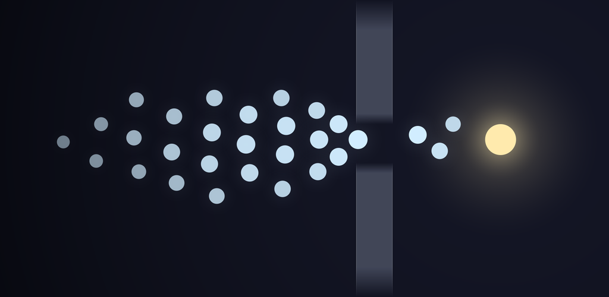
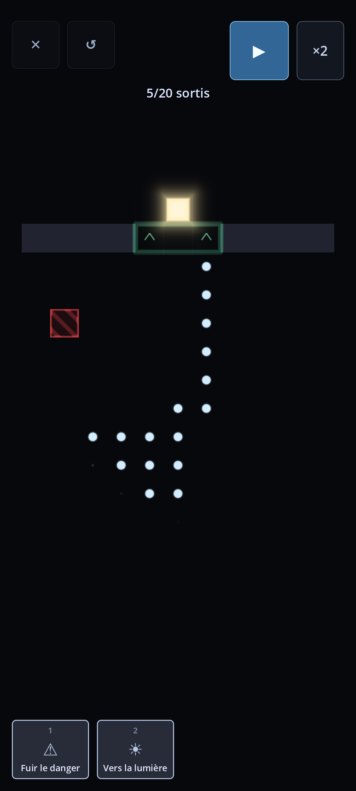
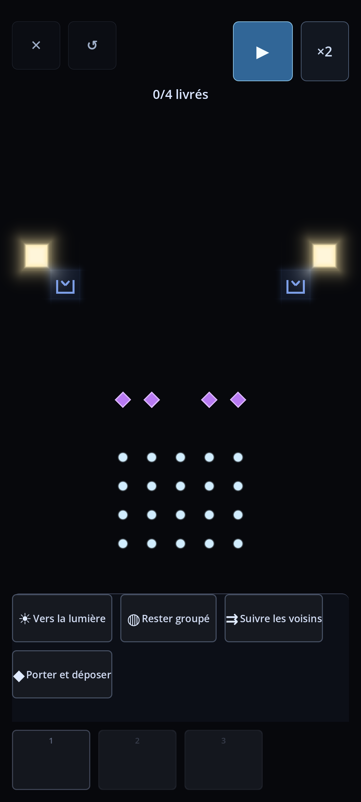
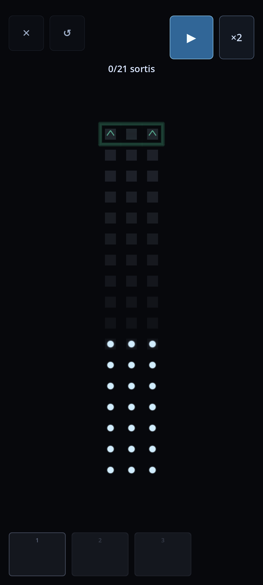
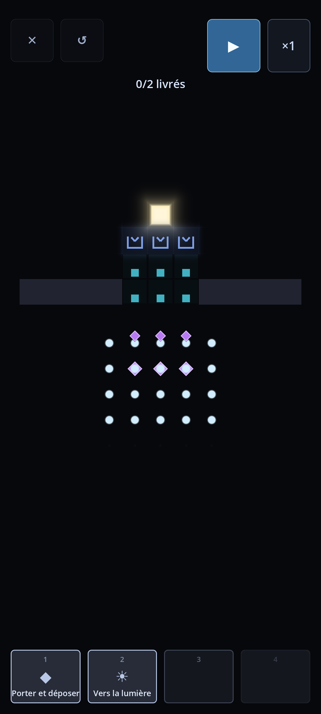
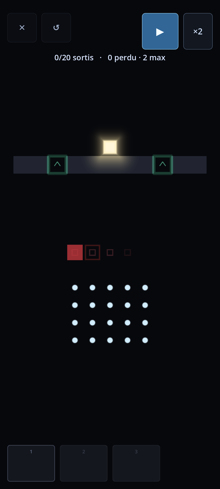
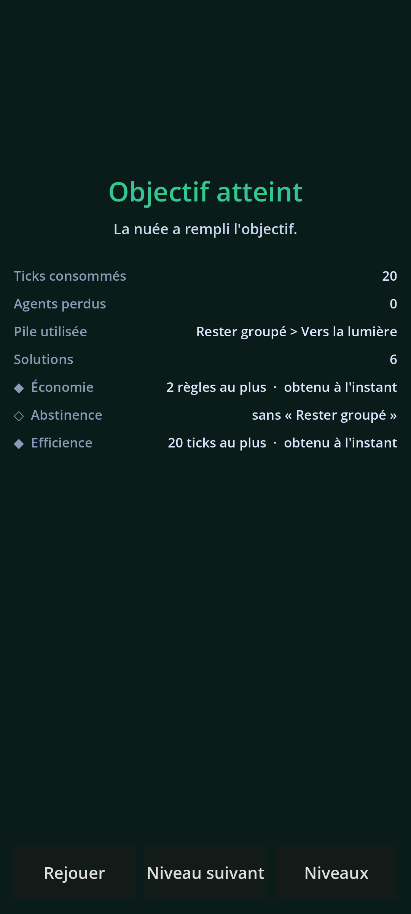

<p align="center"></p>

# Volens

> *Vous ne commandez personne. Vous écrivez les règles qui gouvernent la nuée.*

Volens est un jeu mobile de **puzzle systémique** (Android, portrait, une main). Le joueur ne contrôle jamais un individu : il compose une **pile ordonnée de règles de comportement** qui gouvernent simultanément tous les agents d'une nuée, lance une simulation déterministe, puis observe le comportement collectif qui en émerge.

*English, in short: Volens is an offline, deterministic swarm puzzle game for Android. You never steer an agent — you stack a few behaviour rules, order them by priority, run the simulation and watch what emerges. No ads, no tracking, no network. The project documentation is in French; the game itself is available in French and English.*

**Statut : pré-version 0.1.0, en développement actif.** Le jeu est jouable de bout en bout (38 niveaux, 6 chapitres, 13 règles). Il n'est pas encore publié sur le Play Store ; la cible est la v1.0 en 2027.

## Aperçu

<table>
  <tr>
    <td align="center" width="33%"><br><sub><b>L'ordre décide</b><br>« Fuir le danger » avant « Vers la lumière » : la nuée contourne.</sub></td>
    <td align="center" width="33%"><br><sub><b>Composer la pile</b><br>Trois rangs à remplir parmi les règles débloquées.</sub></td>
    <td align="center" width="33%"><br><sub><b>La mémoire du monde</b><br>Marquer et suivre une piste : l'environnement devient une mémoire partagée.</sub></td>
  </tr>
  <tr>
    <td align="center"><br><sub><b>Transporter</b><br>Porter une ressource jusqu'à un dépôt.</sub></td>
    <td align="center"><br><sub><b>Le danger qui bouge</b><br>Un danger cyclique, à période fixe et visible.</sub></td>
    <td align="center"><br><sub><b>Le bilan et les défis</b><br>Ticks, pertes, pile utilisée et défis optionnels.</sub></td>
  </tr>
</table>

---

## Sommaire

1. [Le principe](#le-principe)
2. [Les règles du jeu](#les-règles-du-jeu)
3. [Principes de conception](#principes-de-conception)
4. [Architecture](#architecture)
5. [Prérequis et installation](#prérequis-et-installation)
6. [Lancer, tester, valider](#lancer-tester-valider)
7. [Créer un niveau](#créer-un-niveau)
8. [Exporter pour Android](#exporter-pour-android)
9. [Vie privée](#vie-privée)
10. [Documentation](#documentation)
11. [État d'avancement](#état-davancement)
12. [Contribuer](#contribuer)
13. [Licence et contact](#licence-et-contact)

---

## Le principe

> **Pour chaque agent, à chaque tick, la première règle de *déplacement* applicable de la pile l'emporte ; les règles d'*effet* s'appliquent au passage, sans consommer la décision.**

Cette phrase contient tout le jeu. Les mêmes règles, dans deux ordres différents, donnent deux nuées sans rapport : « Fuir le danger » avant « Aller vers la lumière » produit une nuée prudente qui contourne ; l'inverse produit une nuée qui fonce et laisse des agents derrière elle. Le joueur ne change que l'**ordre**.

- Aucun ordre n'est donné pendant l'action : il n'y a rien à cliquer une fois la simulation lancée, et aucun réflexe n'est requis.
- Un niveau est réussi quand la nuée satisfait un **objectif** : extraction, collecte, préservation, célérité ou interdiction.
- **Échouer ne coûte rien** : essais illimités, pause, pas à pas, retour dans le temps jusqu'au début de l'essai.
- Chaque niveau propose en plus des **défis optionnels**, qui ne conditionnent jamais la progression.

## Les règles du jeu

La bibliothèque compte **13 règles**, introduites progressivement par chapitre. Le joueur compose une pile de trois ou quatre rangs.

| Chapitre | Thème | Règles |
|---|---|---|
| 1 | Le mouvement élémentaire | R01 Vers la lumière · R02 Fuir le danger · R03 Rester groupé |
| 2 | La coordination | R04 S'écarter · R05 Suivre les voisins · R06 Longer le mur |
| 3 | La mémoire du monde (stigmergie) | R08 Marquer la piste · R09 Suivre la piste |
| 4 | Le transport | R11 Porter et déposer |
| 5 | Le sacrifice et la régulation | R13 Boucher · R14 Disperser si dense · R15 Suivre le plus lent |
| 6 | L'exception | R16 Ignorer (joker) |

Les identifiants R07, R10 et R12 sont retirés ou fusionnés et restent réservés : voir le cahier des charges, §7.2 bis.

Les règles sont de deux genres, et deux seulement : le **proposeur** (propose un déplacement ou s'abstient) et l'**effet** (agit sur le monde puis rend la main). Un effet ne s'applique que si la cascade l'atteint : sa position dans la pile reste décisive.

## Principes de conception

- **Déterminisme strict.** Mêmes choix, même déroulement, sur tout appareil. Aucun hasard ne peut servir d'excuse à un échec. Le déterminisme est vérifié par un corpus de **recettes d'or** (empreintes archivées) rejoué en intégration continue.
- **Pas de dark pattern.** Ni publicité, ni minuteur, ni énergie, ni notification, ni série quotidienne. Un seul achat unique de déblocage est prévu après le premier chapitre gratuit.
- **Fait pour l'interruption.** Reprise exacte de l'état en moins de 3 secondes, une seule main, aucun son requis.
- **Pas de mécanique redondante.** Deux éléments qui font la même chose sont un défaut de conception, pas une richesse.
- **Des niveaux mesurés, pas seulement dessinés.** Un validateur énumère l'espace complet des piles de chaque niveau pour établir ce qui gagne, ce qui perd et pourquoi.

## Architecture

Moteur : **Godot 4.7.1** (version standard, pas .NET), **GDScript** à typage statique.

```
res://
├── core/              # PUR : headless, déterministe, sans dépendance au rendu
│   ├── sim/           #   état, transition de tick, règles, objectifs, empreinte
│   └── replay/        #   recette, clichés-clés, remontée du temps
├── game/              # tout ce qui touche au runtime Godot
│   ├── view/  ui/  audio/  meta/  save/  platform/  selfcheck/
├── data/              # données pures : niveaux (.lvl source, .json généré), i18n
├── tools/             # validateur, convertisseur de niveaux, forge, outils de conception
├── tests/             # unit/  ui/  golden/  arch/
└── docs/              # cahier des charges, conception technique, plan, carnet de bord
```

Les règles de dépendance sont **testées en CI** :

1. `core/` n'importe jamais `game/`.
2. `core/sim/` n'importe que `core/sim/`.
3. `tools/` n'importe que `core/` et `data/`.
4. Le sens autorisé ne remonte jamais : `game/ui → game/view → core/replay → core/sim`.

`core/sim/` est une simulation **pure** : entiers uniquement (aucun `float`), aucun aléatoire, aucune horloge, ordre d'évaluation total et fixe (agents par identifiant croissant, directions départagées Nord > Est > Sud > Ouest), décisions prises sur un cliché immuable. `step()` est une fonction pure.

Le validateur et le jeu partagent **le même code de simulation** : il n'existe pas de seconde implémentation. La liste complète des invariants est dans [`docs/ARCHITECTURE.md`](docs/ARCHITECTURE.md).

## Prérequis et installation

- **Godot 4.7.1-stable**, version standard (non .NET), disponible dans le `PATH` sous le nom `godot`.
- Pour l'export Android seulement : JDK 17, Android SDK (plateforme 36) et les modèles d'export Godot 4.7.1. Voir [`docs/environnement_dev.md`](docs/environnement_dev.md).
- Aucune autre dépendance. Le framework de tests **GUT 9.6.1** est fourni dans `addons/`.

```bash
git clone https://github.com/HelloIAmRomain/Volens.git
cd Volens
godot --headless --path . --import   # première importation des ressources
```

## Lancer, tester, valider

```bash
# Jouer (ouvre une fenêtre au format portrait)
godot --path .

# Simulation headless d'un niveau, avec une pile donnée
godot --headless --path . --script res://tools/run_sim.gd -- --level=test_smoke --ticks=200

# Tests unitaires (GUT)
godot --headless --path . -s addons/gut/gut_cmdln.gd -gdir=res://tests/unit -gexit

# Suite complète : unitaires, interface, architecture, or (environ quatre minutes)
godot --headless --path . -s addons/gut/gut_cmdln.gd -gdir=res://tests -ginclude_subdirs -gexit

# Non-régression du déterminisme (recettes d'or)
godot --headless --path . --script res://tools/check_golden.gd

# Validateur d'un niveau : énumère l'espace des piles et rapporte
godot --headless --path . --script res://tools/validate/run.gd -- --level=ch1_02
```

Une empreinte d'or qui change signale une **régression du déterminisme** : c'est un défaut à corriger, jamais une valeur à mettre à jour.

## Créer un niveau

Les niveaux s'écrivent en `.lvl` (une carte en caractères et ses paramètres) dans `data/levels/`. Le convertisseur produit le JSON consommé par le jeu et recalcule une **empreinte de géométrie** : un niveau dont les paramètres (échéance, seuil, limite de ticks) ont été calibrés sur une autre carte est refusé.

```bash
# Convertir un .lvl en JSON puis le valider
godot --headless --path . --script res://tools/lvl/run.gd -- --in=data/levels/ch1_01.lvl --validate
```

Le dossier `tools/design/` contient les outils de **conception** (ils mesurent, ils ne corrigent rien) : énumération de toutes les combinaisons gagnantes, recherche de la règle à ajouter à un niveau, et une **forge** qui balaie des géométries et n'émet que celles qui portent plusieurs familles de piles gagnantes. Les formats sont décrits dans [`data/README.md`](data/README.md), et chaque niveau a sa fiche dans [`docs/design/`](docs/design/).

## Exporter pour Android

Cibles : `minSdk` 33 (Android 13), `targetSdk` 36 (Android 16), arm64. Identifiant d'application : `com.volensgame.volens`.

```bash
export ANDROID_HOME="$HOME/Android/Sdk"
godot --headless --path . --export-debug "Android" build/volens-debug.apk
```

`export_presets.cfg` n'est **pas versionné** (il contient la configuration de signature) : partez de [`docs/export_presets.cfg.exemple`](docs/export_presets.cfg.exemple). Les clés de signature ne se trouvent jamais dans le dépôt. La seule permission Android déclarée est `VIBRATE` (retour haptique) ; la liste est close et vérifiée par un test (`data/android_permissions.json`).

## Vie privée

Volens est **hors ligne** : aucun compte, aucune publicité, aucune télémétrie, aucune permission réseau, aucune collecte de données. Les sauvegardes restent sur l'appareil. La [politique de confidentialité](https://helloiamromain.github.io/volens-legal/) est publiée, et ses sources sont dans [`docs/legal/`](docs/legal/).

## Documentation

| Document | Contenu |
|---|---|
| [`docs/Volens_cahier_des_charges.md`](docs/Volens_cahier_des_charges.md) | Le **quoi** : exigences fonctionnelles et non fonctionnelles, règles de gestion |
| [`docs/Volens_dossier_conception_technique.md`](docs/Volens_dossier_conception_technique.md) | Le **comment** : décisions techniques et architecture |
| [`docs/Volens_plan_de_production.md`](docs/Volens_plan_de_production.md) | Le **quand** : jalons, lots, tâches |
| [`docs/ARCHITECTURE.md`](docs/ARCHITECTURE.md) | Invariants d'architecture, conventions, commandes |
| [`docs/Volens_dossier_genres_de_regles.md`](docs/Volens_dossier_genres_de_regles.md) | Les genres de règles (proposeur, effet) et ce qui reste gelé |
| [`docs/carnet_de_bord.md`](docs/carnet_de_bord.md) | Journal de développement : décisions numérotées, mesures, échecs |
| [`docs/plan_vdef.md`](docs/plan_vdef.md) | Bilan de la phase « version définitive jouable » |
| [`docs/environnement_dev.md`](docs/environnement_dev.md) | Poste de développement, export Android, appareil |
| [`docs/design/`](docs/design/) | Une fiche de conception par niveau |
| [`docs/store/`](docs/store/) · [`docs/legal/`](docs/legal/) | Fiche Play Store (FR/EN) et documents légaux |

En cas de contradiction entre le cahier des charges, le dossier technique et `docs/ARCHITECTURE.md`, elle est signalée et tranchée par le porteur du projet.

## État d'avancement

| | |
|---|---|
| Règles | 13 |
| Niveaux | 38, répartis sur 6 chapitres (cible v1.0 : 70) |
| Types de case | 9, tous dessinés à l'écran |
| Objectifs | 5, tous employés |
| Localisation | français et anglais, à parité |
| Tests | plus de 470 (unitaires, interface, architecture), plus 72 recettes d'or |
| Intégration continue | GitHub Actions, Godot 4.7.1, Linux x86_64 |
| Export Android | opérationnel (APK de débogage, AAB de release signé) |

**À venir :** campagnes de test avec un panel de joueurs, test fermé Google Play, production du reste du contenu, audio, puis publication.

## Contribuer

Le dépôt est public pour la transparence ; le projet est mené par une personne et **n'accepte pas de contributions de code pour l'instant**. Les retours sont les bienvenus : ouvrez une *issue* pour signaler un défaut, un niveau injuste ou une règle peu lisible.

Si vous consultez le code, quelques conventions : typage statique partout, Conventional Commits (`feat(sim): …`), une branche par lot, `main` protégée, et tout ajout dans `core/` accompagné de ses tests dans le même commit.

## Licence et contact

© 2026 Romain Dodet — **tous droits réservés**. Le code source est publié pour consultation ; sa réutilisation, sa modification et sa redistribution ne sont pas autorisées sans accord écrit. Le moteur Godot (licence MIT) et GUT (licence MIT, dans `addons/gut/`) conservent leurs propres licences.

Éditeur : **Draille** · Contact : volens.game@proton.me
